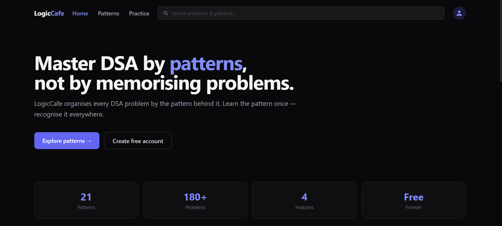
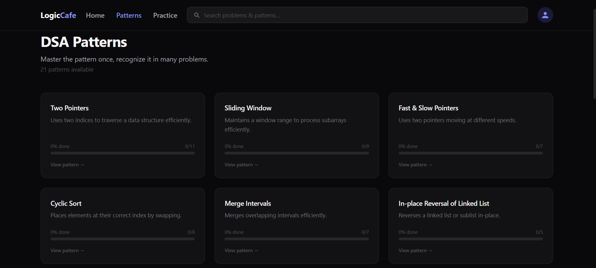
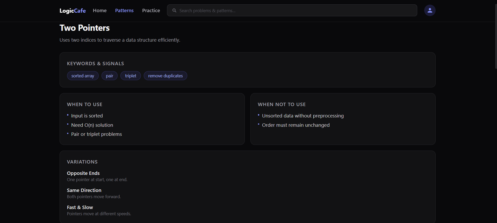
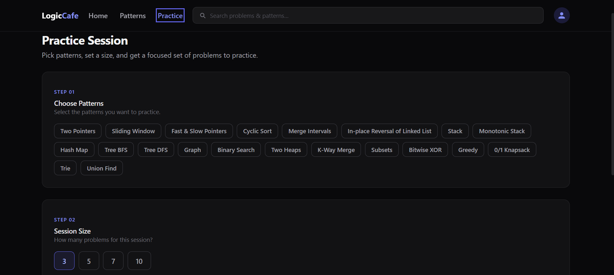

# LogicCafe

LogicCafe is a MERN-based DSA learning platform that helps students master Data Structures & Algorithms through pattern-based learning. Instead of memorizing individual problems, users learn core patterns and apply them across multiple questions.

## Live Demo

Frontend: https://logic-cafee.vercel.app

Backend: https://logiccafe-backend.onrender.com

## Features

* Pattern-wise DSA learning
* Focused practice sessions
* Progress tracking
* Search patterns and problems
* JWT Authentication
* Google OAuth Login
* Protected routes
* Responsive UI

## Tech Stack

### Frontend

* React
* Vite
* React Router
* Tailwind CSS
* Axios

### Backend

* Node.js
* Express.js
* JWT Authentication
* Google OAuth

### Database

* MongoDB Atlas
* Mongoose

### Deployment

* Vercel (Frontend)
* Render (Backend)

## Screenshots

### Home Page



### Patterns Page



### Pattern Detail Page



### Practice Page



## Local Setup

### Clone Repository

```bash
git clone https://github.com/lokesh040306/LogicCafee.git
cd LogicCafee
```

### Backend

```bash
cd backend
npm install
npm run dev
```

### Frontend

```bash
cd frontend
npm install
npm run dev
```

## Environment Variables

### Backend

```env
MONGO_URI=
JWT_SECRET=
GOOGLE_CLIENT_ID=
GOOGLE_CLIENT_SECRET=
CLIENT_URL=
```

### Frontend

```env
VITE_API_URL=
VITE_BACKEND_URL=
```
